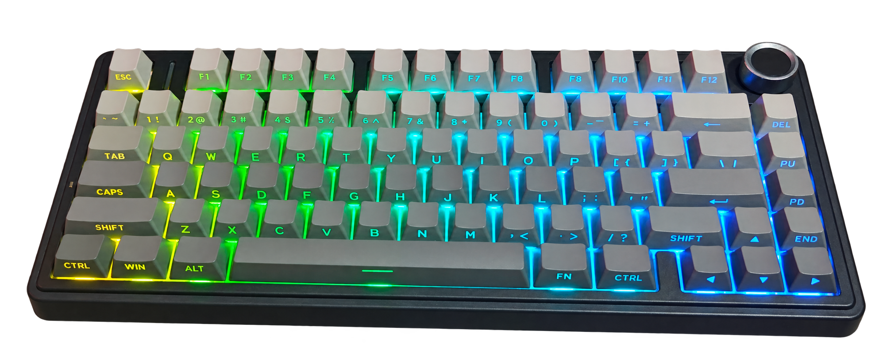
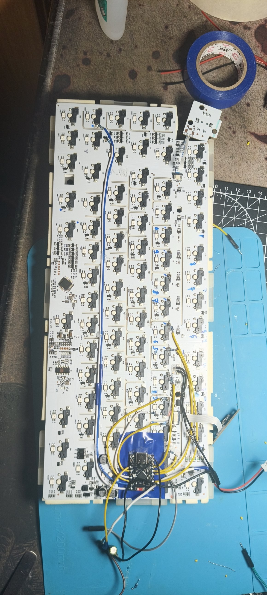
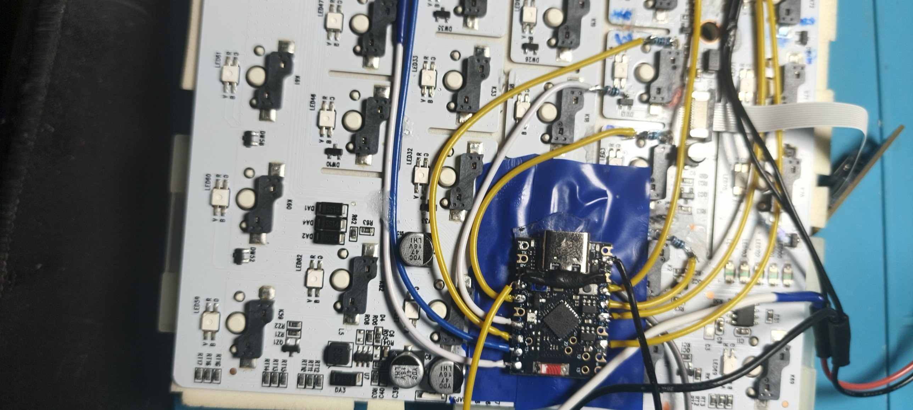
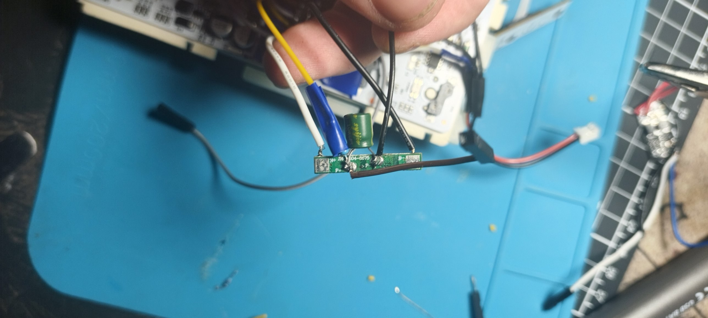
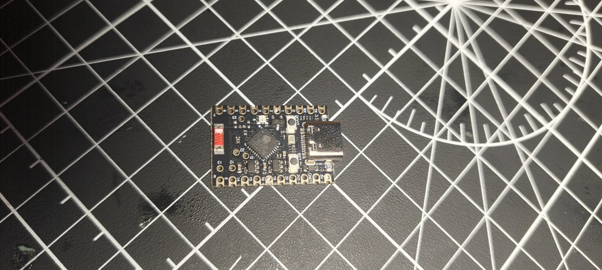
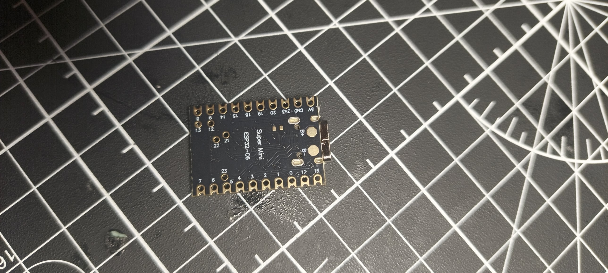

<div align="right">

🌐 [English](https://github.com/VITAZGIO/ESP32-c6_KEYBOARD/blob/main/README.md) · **Русский**

</div>

<div align="center">

# ⌨️ AULA F75 → Zigbee-кнопки

### Обычная клавиатура, которая умеет управлять умным домом




</div>

---

## 👋 Что это такое

Маленькая плата **ESP32-C6 SuperMini** (микроконтроллер с радиомодулем Zigbee), встроенная
внутрь механической клавиатуры **AULA F75**.

Клавиши **End + 1…6** превращаются в **12 беспроводных кнопок** для Home Assistant. Нажал
сочетание — сработала автоматизация: свет, розетка, чайник, сцена, что угодно.

- 🖥️ **ПК не нужен.** Плата работает сама, даже когда компьютер выключен.
- 🔌 **Работает в любом режиме клавиатуры:** по проводу, 2.4G и Bluetooth.
- 🧠 **Клавиатуру не ломает.** Плата только слушает матрицу и ничего в неё не подаёт. End остаётся обычной клавишей.
- 🔋 **Питание от родного Li-Po** клавиатуры (4000 мА·ч). Во сне **меньше 1 мА**.
- ⚡ **Мгновенно.** Просыпается за доли миллисекунды, ловит даже быстрое нажатие.
- 📡 В **Zigbee2MQTT** видна как **VITAZGIO / AulaKeys**.
- 🔄 **Прошивка по воздуху (OTA)** через Wi-Fi, разбирать клавиатуру не нужно.

> 💡 **Zigbee** — низкопотребляющий беспроводной протокол для умного дома. **Zigbee2MQTT** —
> программа, которая подключает такие устройства к Home Assistant без фирменных хабов.
> **End Device** — устройство, которое только отправляет свои данные и не ретранслирует
> чужие, поэтому может спать и экономить батарею.

---

## 🧰 Что понадобится

| Что | Зачем |
|---|---|
| Клавиатура AULA F75 (плата `SI-2635-916-3632-V02`) | сама клавиатура |
| **ESP32-C6 SuperMini** (флеш 4 МБ, площадки `B+`/`B−` под батарею) | мозг проекта и Zigbee-радио |
| BMS 1S (плата защиты аккумулятора, DW01A + 8205A) | чтобы не посадить Li-Po в ноль |
| Электролитический конденсатор ~220 мкФ 16 В | сглаживает скачки тока при передаче |
| 8 резисторов 10 кОм + 2 по 20 кОм | подключение к матрице + делитель батареи |
| Тонкие провода, каптон/изолента | разводка и изоляция |
| Zigbee-координатор + Zigbee2MQTT | приём кнопок |

Паяльник и аккуратность — обязательны 🙂

---

## 🔧 Как выглядит внутри

Вся плата клавиатуры с ESP32-C6 SuperMini на изоленте. Жёлтые провода идут к цифрам,
белый и синий — к End, снизу приходит питание от батареи.

<div align="center">

</div>

Плата крупно. Все провода на краевых пинах, последовательные резисторы стоят прямо у
точек матрицы.

<div align="center">

</div>

Плата защиты аккумулятора (BMS) с конденсатором. Её выход `P+`/`P−` идёт на площадки
`B+`/`B−` платы SuperMini.

<div align="center">

</div>

Сама ESP32-C6 SuperMini сверху и снизу. Площадки `B+`/`B−` на обороте — вход батареи.

<div align="center">


</div>

---

## 🧭 Содержание

[Как это работает](#как-это-работает) ·
[Сочетания клавиш](#сочетания-клавиш) ·
[Распиновка](#распиновка) ·
[Питание](#-питание) ·
[Прошивка](#прошивка-по-usb-первый-раз) ·
[OTA](#прошивка-по-воздуху) ·
[Zigbee2MQTT](#zigbee2mqtt) ·
[Диагностика](#диагностика)

---

## Как это работает

Клавиши в клавиатуре соединены **матрицей** (сеткой из строк и столбцов). Родной
контроллер по очереди дёргает **линии скана** и смотрит, какая **линия чтения** уходит в
ноль — так узнаёт, какая клавиша нажата.

ESP в этом не участвует, она **подслушивает**: на каждый спад линии скана ловит
прерывание (мгновенный сигнал процессору) и в этот момент читает линии чтения. Два скана
подряд линия в нуле — клавиша действительно нажата.

**Сон.** Когда ничего не нажато, клавиатура перестаёт сканировать, матрица молчит. ESP
в это время в **light sleep** (процессор остановлен, память сохранена, просыпается быстрее
миллисекунды) и ждёт, когда линия чтения End уйдёт в ноль. Будит любая клавиша из ряда
End, дальше ESP по линии скана End проверяет, что нажата именно End.

**Радио.** Плата — спящий Zigbee End Device. После подключения бодрствует 10 секунд,
потом выключает приёмник и раз в 3 секунды спрашивает координатора, нет ли для неё
сообщений. Нажатия уходят напрямую координатору.

Поэтому всё работает **в любом режиме** клавиатуры (провод, 2.4G, BT) и не зависит от
того, что решила отправить её родная прошивка.

---

## Сочетания клавиш

Режим решает то, что было с End **до** рабочего зажатия. Цифры везде срабатывают
мгновенно.

| Что сделал с End до | Потом зажал End + цифра | Результат |
|---|---|---|
| ничего | цифра 1…6 | `Btn 1`…`Btn 6` |
| тапнул коротко (меньше 0,6 с) и отпустил | цифра 1…6 | `Btn 1 dbl`…`Btn 6 dbl` |
| подержал 2 секунды и отпустил | End + любая из **1, 2, 3** | сброс сети Zigbee |
| подержал 2 секунды и отпустил | End + любая из **4, 5, 6** | режим OTA (Wi-Fi, 10 минут) |

Флаг взводится **в момент отпускания End** и живёт **3 секунды**. Он одноразовый:
использовал — сбросился. Если во время удержания End нажимал цифры, это обычная работа,
флаг не взводится.

В сервисном режиме в сеть ничего не уходит. Хватает **обычного нажатия одной цифры**.

---

## Распиновка

Все пины на краях платы. Каждая линия матрицы — через **последовательный резистор 10 кОм**.

| GPIO | Что | Через |
|---|---|---|
| GPIO6 | End: линия чтения (ножка кнопки) | 10к послед. |
| GPIO7 | End: линия скана (со стороны диода) | 10к послед. |
| GPIO4 | Ряд цифр: линия скана (общая, со стороны диодов) | 10к послед. |
| GPIO19 | Цифра 1: линия чтения | 10к послед. |
| GPIO2 | Цифра 2: линия чтения | 10к послед. |
| GPIO5 | Цифра 3: линия чтения | 10к послед. |
| GPIO20 | Цифра 4: линия чтения | 10к послед. |
| GPIO18 | Цифра 5: линия чтения | 10к послед. |
| GPIO14 | Цифра 6: линия чтения | 10к послед. |
| GPIO1 | Напряжение батареи | делитель 20к/20к |
| `B+` / `B−` | Батарея после BMS | напрямую |

Не занимать: GPIO8 (RGB-светодиод), GPIO9 (BOOT), GPIO15 (светодиод), GPIO12/13 (USB),
GPIO16/17 (UART).

**Только последовательный резистор, без резисторов на землю и подтяжек.** Всё, что
тянет линию на землю или на 3,3 В, подгружает матрицу — клавиатура начинает видеть
залипшие клавиши.

### Точки на плате клавиатуры (SI-2635-916-3632-V02)

- **линия чтения** — контакт гнезда свича, который НЕ идёт на диод
- **линия скана** — сторона диода. Маленькие трёхногие детали с маркировкой `A3` — это
  сдвоенные диоды (похожи на транзисторы). Один корпус обслуживает две соседние клавиши.
- Детали `J3Y` — транзисторы подсветки, к матрице отношения не имеют.

Если End не будит плату (в логе `пробуждений 0`), поменяй местами `PIN_END` и
`PIN_END_SCAN` в `src/config.h`.

---

## ⚡ Питание

```
Аккум (+) ─────────────────────────┬── клавиатура (как с завода)
Аккум (−) ─────────────────────────┤
                                   │
                    [BMS 1S]  вход B+/B−, выход P+/P−
                         P+ ──┬────── B+  (площадка снизу ESP32-C6 SuperMini)
                              ═ 220 мкФ
                         P− ──┴────── B−

B+ ──[20к]──┬── GPIO1
            └─[20к]── GND
```

- У SuperMini **свой вход под Li-Po** (`B+`/`B−`) с зарядкой и стабилизатором с малым
  падением напряжения. **Повышайка не нужна**, батарея подключается напрямую.
- **BMS** (плата защиты аккумулятора) отключает ESP, когда батарея почти пустая, и не
  даёт посадить Li-Po в ноль.
- **Конденсатор** (электролит, соблюдай полярность: полоска — минус) отдаёт ток в
  короткие всплески, когда радио передаёт.
- **USB и батарея одновременно** на этой плате — можно. Но пока USB воткнут, зарядка
  платы подзаряжает и батарею клавиатуры, так что подолгу так не держи.
- На пин `3V3` ничего снаружи не подавать, пин `5V` не подключать.

### Замеры тока

| Состояние | Ток от батареи |
|---|---|
| Отправка кнопки (~2 с) | ~24 мА |
| Сон, в сети Zigbee | **меньше 1 мА** (ниже шага 1 мА моего мультиметра) |

На фоне самой клавиатуры ESP почти ничего не ест.

### Заряд батареи

Делитель пополам: 4,2 В → 2,1 В. Отправляется в Zigbee при подключении и раз в 6 часов.
Если процент врёт — подстрой `BAT_MIN_MV` / `BAT_MAX_MV` в `config.h`.

---

## Антенна

Верхняя плита клавиатуры металлическая. Плату класть к пластиковому низу, антенной
(красный керамический чип) к краю корпуса, подальше от плиты, аккумулятора и антенны
`ANT2` самой клавиатуры.

---

## Прошивка по USB (первый раз)

Прошивка написана на **ESP-IDF 5.4** (родной фреймворк Espressif), собирается в
**PlatformIO** (`framework = espidf`).

Перед первой сборкой:

```
src/secrets.example.h  →  src/secrets.h     (Wi-Fi и пароль OTA)
secrets.example.ini    →  secrets.ini       (IP платы и пароль OTA для заливки)
```

Оба файла в `.gitignore`, в репозиторий не попадают.

1. Кабель **с передачей данных** (надёжнее USB-A → USB-C) в **задний порт** ПК, не в хаб.
   С плохим кабелем будет «сбой запроса дескриптора устройства».
2. Режим прошивки: **зажать BOOT → воткнуть USB (или нажать RST) → отпустить BOOT**.
3. Залить:

```
pio run -e esp32-c6 -t upload
pio device monitor -p COMxx
```

Внешний переходник USB-UART не нужен: у SuperMini встроенный USB.

> ⚠️ Держи проект в простой папке вроде `C:\pio\aula-keys`: без кириллицы, без пробелов,
> не в Nextcloud/OneDrive. Синхронизация блокирует файлы, и сборка падает с
> `PermissionError ... .sconsign`.

После правки `sdkconfig.defaults` или `ota.csv` удаляй `sdkconfig.esp32-c6*` и папку `.pio/`.

---

## Прошивка по воздуху

1. На клавиатуре: **подержать End 2 секунды → отпустить → End + любая из 4, 5, 6**
2. ESP перезагружается в Wi-Fi со **статическим IP `192.168.1.210`** и ждёт **10 минут**.
   Проверить: `http://192.168.1.210/`.
3. Залить:

```
pio run -e esp32-c6-ota -t upload
```

IP задаётся в `src/config.h` (`OTA_IP`, `OTA_GATEWAY`) и в `secrets.ini` (`upload_port`).
Пароль — `OTA_PASSWORD` в `secrets.h` и `password` в `secrets.ini`, они должны совпадать.

Разметка `ota.csv` держит два раздела под программу (`ota_0` / `ota_1`) на флеше 4 МБ.
Если новая прошивка падает при старте, загрузчик откатывается на прежнюю.

---

## Zigbee2MQTT

1. `zigbee2mqtt/aulakeys.js` → в папку z2m, рядом с `configuration.yaml`
2. В `configuration.yaml`:

```yaml
external_converters:
  - aulakeys.js
```

3. Перезапустить z2m
4. **Permit Join только на координаторе** (не через роутеры: через некоторые роутеры
   спящее устройство теряет родителя)
5. Плата подключится как **VITAZGIO / AulaKeys**

Новая плата — новый адрес, поэтому появится новым устройством. Старое удали, новому
дай то же имя — сущности в Home Assistant останутся прежними.

### Сущности

| Сущность | Комбинация |
|---|---|
| `Btn 1`…`Btn 6` | зажал End + цифра |
| `Btn 1 dbl`…`Btn 6 dbl` | тап End, затем зажал End + цифра |
| `battery` | процент заряда, при подключении и раз в 6 часов |

Каждая кнопка — импульс: `ON` на 300 мс, потом `OFF` (и ещё два повтора `OFF` на случай
потери пакета). В HA вешай автоматизацию на переход в `ON`.

---

## AutoHotkey на ПК

End осталась обычной клавишей, поэтому, чтобы End + цифры не печатались в Windows,
положи в автозагрузку (`Win+R` → `shell:startup`):

```
#Requires AutoHotkey v2.0

End & 1::return
End & 2::return
End & 3::return
End & 4::return
End & 5::return
End & 6::return
```

Одиночные цифры печатаются как обычно. Когда ПК выключен, скрипт не нужен.

---

## Настройки в коде (`src/config.h`)

| Константа | Смысл |
|---|---|
| `TAP_MAX_MS` | End короче этого = заявка на второй ряд (600) |
| `SERVICE_HOLD_MS` | End дольше этого = заявка на настройки (2000) |
| `ALT_WINDOW_MS` / `SERVICE_WINDOW_MS` | сколько живёт флаг (3000) |
| `END_PRESS_SCANS` / `DIGIT_PRESS_SCANS` | сколько сканов подряд = нажатие (2) |
| `SCAN_SILENCE_MS` | сканов нет столько = всё отпущено (40) |
| `PULSE_MS` | длительность импульса кнопки (300) |
| `OFF_RETRIES` / `OFF_RETRY_MS` | повторные `OFF` (2 × 900 мс) |
| `BAT_REPORT_MS` | период отчёта батареи (6 ч) |
| `OTA_TIMEOUT_MS` | сколько ждать прошивку в режиме OTA (10 мин) |
| `TEST_NO_ZIGBEE` | 1 = не запускать Zigbee (тест тока), рабочее значение 0 |

`DEBUG_PM` в `main.c` раз в 30 секунд пишет статистику сна: `пробуждений N, нажатий End M`.

---

## Диагностика

| Симптом | Причина / лечение |
|---|---|
| «Сбой запроса дескриптора устройства» | плохой кабель или передний порт/хаб. Кабель с данными, задний порт |
| `Write timeout` / `No serial data` при заливке | плата не в режиме прошивки: зажать BOOT, нажать RST, отпустить BOOT |
| `PermissionError ... .sconsign` | проект в Nextcloud/OneDrive, перенести в простую папку |
| End не работает, `пробуждений 0` | перепутаны `PIN_END` / `PIN_END_SCAN` |
| Во сне десятки мА | включены `PM_POWER_DOWN_PERIPHERAL_IN_LIGHT_SLEEP` или `ESP_SLEEP_POWER_DOWN_FLASH`. На C6 с ними чип просыпается ~300 раз в секунду. Держать обе выключенными |
| После первого сна радио не передаёт | обязательно `CONFIG_ESP_PHY_MAC_BB_PD=y` |
| Клавиатура видит залипшие клавиши | на линии матрицы резистор на землю/подтяжка, оставить только последовательный |
| Не появляется в z2m | не сброшена сеть: сервисный аккорд (End 2 с → End + 1) или `erase_flash`, потом Permit Join |
| Статус `0x09` / устройство недоступно | подключилась через роутер: сопрягать с Permit Join на координаторе |
| Плата перезагружается при замере тока через резистор | всплески радио ~100 мА. Резистор не больше 10 Ом плюс большой конденсатор, или 1 Ом |

---

## Файлы проекта

```
ESP32-c6_KEYBOARD/
├── platformio.ini            конфиг сборки, два окружения (USB / OTA)
├── sdkconfig.defaults        настройки ESP-IDF (Zigbee, сон, консоль)
├── ota.csv                   разметка флеша 4 МБ с двумя разделами под OTA
├── CMakeLists.txt
├── secrets.example.ini       шаблон → secrets.ini
├── README.md                 документация (английский)
├── README.ru.md              документация (русский)
├── src/
│   ├── config.h              все пины и тайминги
│   ├── main.c                матрица, режимы, сон
│   ├── zb.c / zb.h           Zigbee
│   ├── ota.c / ota.h         прошивка по Wi-Fi
│   ├── battery.c / .h        замер батареи
│   ├── idf_component.yml     зависимость esp-zigbee-lib
│   └── secrets.example.h     шаблон → secrets.h
└── zigbee2mqtt/
    └── aulakeys.js           внешний конвертер для z2m
```

Не попадают в git: `src/secrets.h`, `secrets.ini`, `.pio/`, `sdkconfig.*`, `managed_components/`.

---

**Проект:** AULA F75 Zigbee Keys · Zigbee End Device · VITAZGIO
